# ОТЧЁТ О ПРАКТИЧЕСКОЙ РАБОТЕ №2

**Тема:** Теория автоматов, языков и вычислений. Регулярные выражения, грамматики и языки

**Преподаватель:** Н. С. Черных

**Студент:** К. Е. Зражевский, группа КИ24-16/2Б, зачётная книжка 032435962

**Город, год:** Красноярск, 2026

---

## 1. Цель работы

Реализация и исследование регулярных выражений, регулярных грамматик и свойств регулярных языков, а также доказательство нерегулярности языков.

---

## 2. Задачи

1. Построить регулярное выражение для языка **L12** над алфавитом `{a, b, c}`: строки, **не содержащие подстроку `aaa`**.
2. Построить регулярную грамматику для языка **L12**.
3. Реализовать РВ и РГ в системе JFLAP.
4. Доказать непринадлежность языка **L38** = `{ aⁿbaⁿ | n ≥ 1 }` к классу регулярных языков с использованием леммы о разрастании.

---

## 3. Используемые программные средства

- **JFLAP 7.1** — система для построения и проверки регулярных выражений, грамматик и конечных автоматов.
- **Java (JDK 25)** — для запуска JFLAP.

---

## 4. Часть 1. Регулярное выражение для L12

### 4.1. Регулярное выражение
(b|c)(a|aa)?((b|c)+(a|aa)?)

- `(b|c)*` — произвольное число `b` и `c` в начале;
- `(a|aa)?` — необязательный блок из одной или двух `a`;
- `((b|c)+(a|aa)?)*` — повторяющиеся блоки: один или более `b`или`c`, за которыми может идти 0, 1 или 2 `a`.

### 4.2. Преобразование РВ в КА в JFLAP

### Преобразование РВ в НКА в JFLAP даёт автомат Томпсона с большим числом состояний.

Рисунок 1 — Обобщённый граф переходов

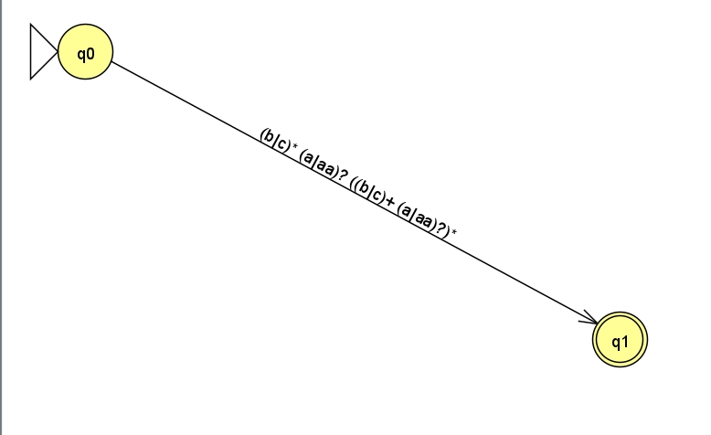

Рисунок 2 — Пошаговое преобразование РВ в НКА (шаг 1)

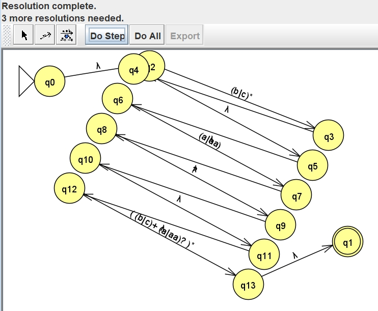

Рисунок 3 — Пошаговое преобразование РВ в НКА (шаг 2)

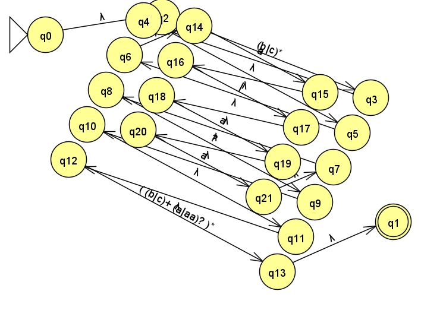

### **Итоговый НКА**

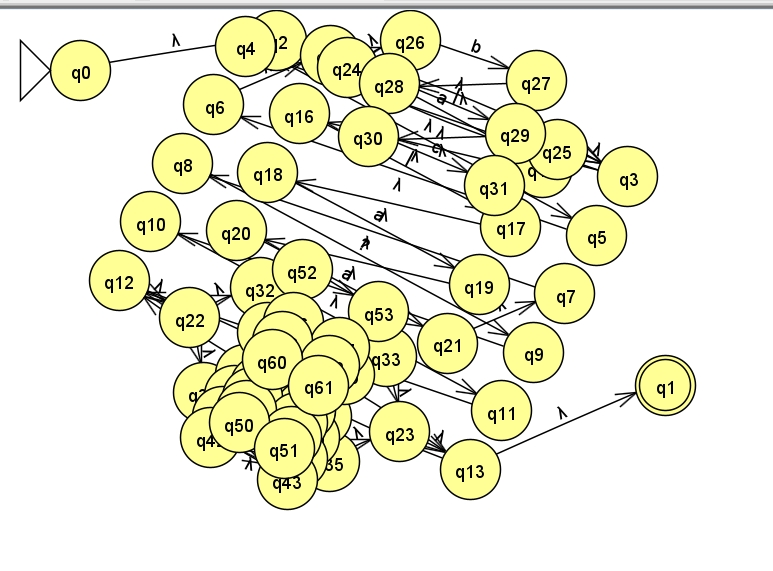

### **Эквивалентный ДКА**

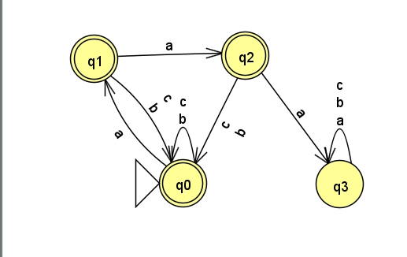

## 5. Часть 2. Регулярная грамматика для L12

### 5.1. Правила грамматики

Нетерминалы: `S`, `A`, `B`.

Терминалы: `a`, `b`, `c`.

S → ε | aA | bS | cS

A → ε | aB | bS | cS

B → ε | bS | cS
- `S` — 0 подряд идущих `a`;
- `A` — 1 `a`;
- `B` — 2 `a`.

Из `B` нет перехода по `a`, поэтому `aaa` невозможно.

Эквивалентное РВ:
(b|c)*(a|aa)?((b|c)(a|aa)?)*

### 5.2. Преобразование РГ в КА в JFLAP, а также в РВ

Рисунок 6 — Исходный граф РГ

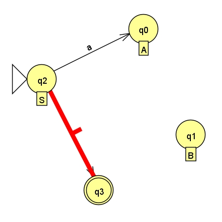

Рисунок 7 — Пошаговое преобразование РГ в КА (шаг 2)

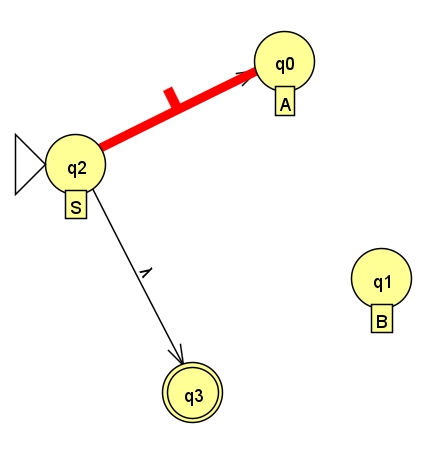

Рисунок 8 — Пошаговое преобразование РГ в КА (шаг 3)

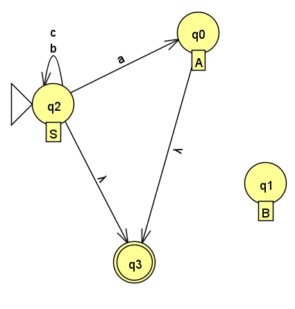

Рисунок 9 — Пошаговое преобразование РГ в КА (шаг 4)

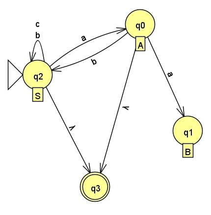

Рисунок 10 — Пошаговое преобразование РГ в КА (шаг 5)

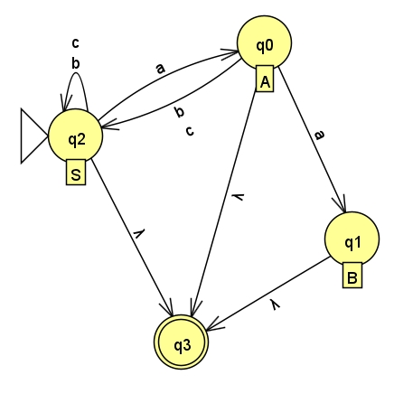

Рисунок 11 — Итоговый КА, построенный по РГ

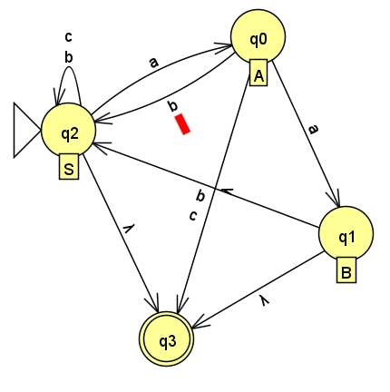

### Преобразование в РВ

Рисунок 12 — Преобразование КА в РВ (шаг 1)

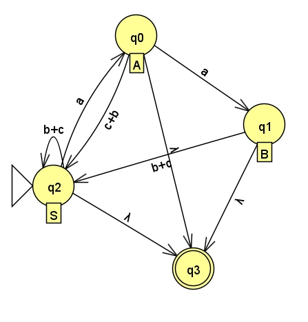

Рисунок 13 — Преобразование КА в РВ (шаг 2)

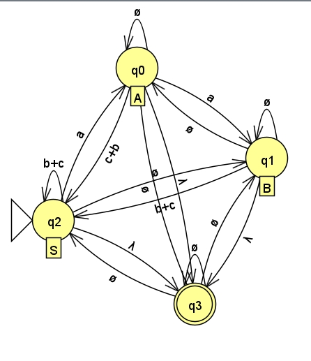

Рисунок 14 — Преобразование КА в РВ (шаг 3)

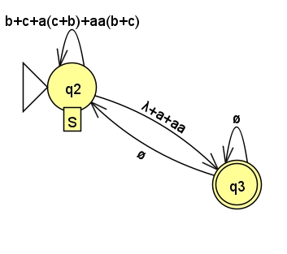

Рисунок 15 — Итоговое РВ, полученное в JFLAP

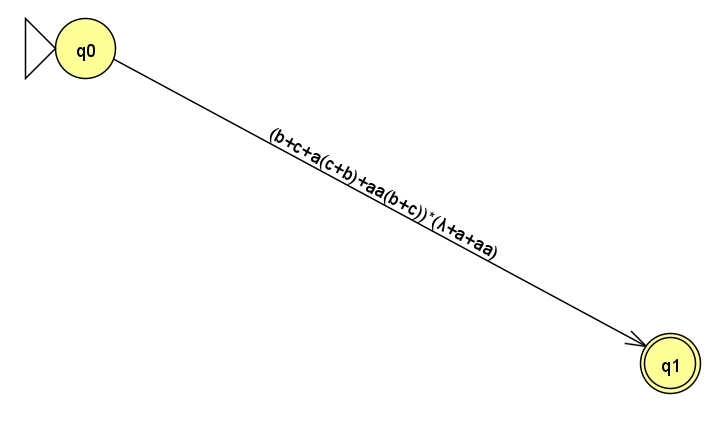

**Итоговое РВ**

(b|c)*(a|aa)?((b|c)(a|aa)?)*

## 6. Часть 3. Доказательство нерегулярности L38

### 6.1. Язык
L38 = { aⁿbaⁿ | n ≥ 1 }
### 6.2. Лемма о разрастании

Если `L` — регулярный язык, то существует `p ≥ 1` такое, что любую цепочку `w ∈ L` с `|w| ≥ p` можно разбить на `w = xyz`, где:

1. `|xy| ≤ p`,
2. `|y| ≥ 1`,
3. `xyⁱz ∈ L` для всех `i ≥ 0`.

### 6.3. Доказательство

Предположим, что `L38` регулярен. Пусть `p` — длина из леммы.

Возьмём цепочку `w = aᵖ b aᵖ ∈ L38`. Тогда `|w| = 2p + 1 ≥ p`.

Разобьём `w = xyz`, где `|xy| ≤ p`, `|y| ≥ 1`.

Так как `|xy| ≤ p`, то `xy` состоит только из `a` (первые `p` символов — это `a`). Значит, `y = aᵏ`, где `k ≥ 1`.

Возьмём `i = 0` (уберём `y`):
xy⁰z = xz = a^(p−k) b aᵖ

Слева от `b` — `p − k` букв `a`, справа — `p`. Так как `k ≥ 1`, то `p − k ≠ p`. Значит, `xz ∉ L38`.

**Противоречие** с леммой.

**Вывод:** `L38` **не является регулярным языком**.